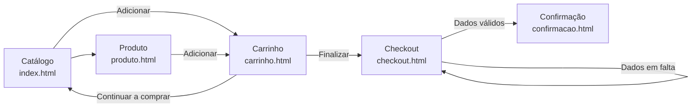

# User flow: Loja Morabeza

## Fluxo do cliente

Para ver o diagrama, colar o bloco acima em https://mermaid.live.

## Perguntas por ecrã

| Ecrã | O que o cliente quer fazer | Passo seguinte | E se falhar? |
|---|---|---|---|
| Catálogo | Encontrar um produto | Ver produto ou adicionar | Mensagem "Sem produtos nesta categoria" |
| Produto | Decidir se compra | Adicionar ao carrinho | Produto não existe: voltar ao catálogo |
| Carrinho | Rever a compra | Finalizar | Carrinho vazio: botão para o catálogo |
| Checkout | Pagar e receber | Confirmar encomenda | Campos inválidos: mensagem por campo |
| Confirmação | Ter a certeza de que correu bem | Voltar à loja | Sem encomenda: voltar ao catálogo |
